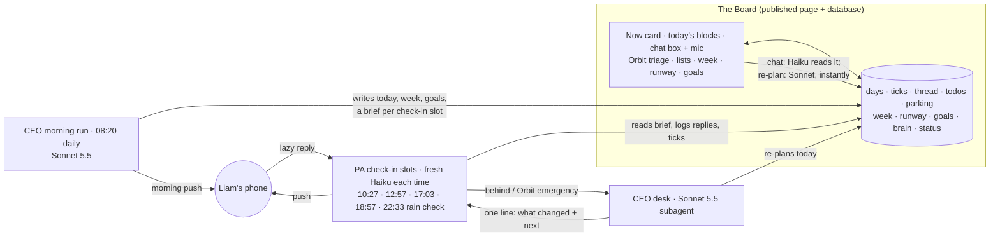

# CEO of Liam

A planning system Liam doesn't have to manage. A CEO model holds the plan, a PA model checks in through the day, and one page (the Board) shows everything and takes his lazy one-line replies.

- **The Board:** https://claude.ai/artifact/3sNAjRQVb2w98ytrrqhhaj (private to Liam). Source: [`board/index.html`](../board/index.html).
- **Rules everyone follows:** [`playbook.md`](playbook.md). **Course facts:** [`facts.md`](facts.md). **Run instructions:** [`prompts.md`](prompts.md).

## Version 2 (20 Nov 2026): your time, held to it

On 20 Nov the first version argued with Liam. It asked Orbit triage questions, put back lunch and Hand-In 4 after he'd said they were done, inserted a 40-minute snack-and-movement block, and re-planned the day five times in four minutes. His brief for the fix: *"Picking what I spend my time on is not difficult. It's sticking to the amount of time that I set out for each thing."* And: school stops at 20:00, after which he works on Orbit.

- **He decides what and for how long.** Simple edits (start a box, done, +15, set the time, remove) happen instantly on the Board with no model involved. The CEO only touches the plan when he asks to rearrange the day, and then changes only what he asked about.
- **Every block is a time box.** The Board shows a big countdown that turns red when he's over, chimes when time's up, and books a phone push for the moment it's due (a one-off scheduled task the page creates through the Claude Code Remote connector when he taps Start, and deletes when he taps Done). Switching boxes cuts the running one at that moment and moves the rest of its time to straight after the new box.
- **School stops at 20:00.** The focus view shows school time left and Orbit minutes spent before 8pm. Orbit before 20:00 is never blocked; the cost is stated plainly. The rain check is now a 20:03 school-day wrap-up, and nothing nags after it.
- **The focus view** (the default tab) shows only the running box, the school clock and the chat box. The plan, questions, messages, lists, week, runway and goals sit behind tabs.
- **No triage, no inserted meals or movement.** Lunch and dinner are short blocks he can remove with one word.

## The design in one paragraph

The system's memory is the Board's database, not a chat. Every model run is short and fresh: it reads the database, does one job, writes back, and ends. So there's no ultra-long session to babysit, and a run that fails takes nothing else down with it. The CEO (Sonnet 5.5) plans each morning and re-plans on demand. The PA (Haiku 5.5) is a fresh session at every check-in slot: it reads the brief the CEO wrote for that slot, sends one push, and handles Liam's reply. When a reply needs a re-plan, the PA calls the CEO desk, a Sonnet subagent that rewrites the day and hands back one line. The Board shows the plan, takes ticks and messages, and can call the CEO itself for an instant re-plan.

## A day

| When | What runs | What Liam sees |
|---|---|---|
| 08:20 | **CEO morning run.** Reads yesterday's ticks and rain check, updates the timing model, re-cuts the next 7 days and the runway, writes today's blocks and a purpose for each check-in slot, updates goals. On Mondays it also does the weekly review. | One push: today's main thing, the first block, a meditation nudge. The Board is up to date. |
| 10:27 · 12:57 · 17:03 · 18:57 (weekends: 12:57 · 17:03) | **PA check-ins.** Each is a fresh Haiku that reads the Board and sends one line: "EP wrapped? Eat, then Hand-In 4 at 17:30. done / still going / stuck". | He replies in one line (Wispr Flow), or ticks on the Board. |
| Any time | **Board chat.** Haiku reads his message and files it (tick, to-do, parking, note for the CEO). If the plan needs changing, Sonnet re-plans the rest of today on the spot and says what changed. Undo is one tap. | "I'm behind" gives a new plan in under a minute. |
| Any time | **Orbit triage** on the Board: three yes/no questions. All yes: a capped fix block is inserted and the day re-flows. Otherwise: parked for the next Orbit block. | A decision instead of an argument with himself. |
| Push reply says "behind" | **CEO desk.** The PA hands his words to a Sonnet subagent, which re-plans the rest of today on the Board and gives back one line. | A reply in the same chat with the new next step. |
| 22:33 | **Rain check** (PA). On Sundays it doubles as the weekly vibe check. | "What got done, what didn't?" He dumps a line; it becomes the day's report. |

## How this maps to what Liam asked for

| Liam's idea | What's built | Why |
|---|---|---|
| Sonnet "CEO" holds the big plan | CEO morning run + CEO desk + the Board's re-plan button, all Sonnet 5.5 (medium effort on the Board; scheduled tasks can't set effort). | |
| A fresh Haiku PA every day, deleted at night after it reports | A fresh Haiku at **every check-in slot**, with the CEO's daily brief (`days/{date}.paBrief` plus a purpose per slot) and the database as its memory. The rain-check PA writes the day's report the CEO reads next morning. | Same shape (CEO → fresh PA → report → CEO), but nothing long-lived to crash or fill up. Nothing to delete either: each run ends by itself. |
| Plan a week at a time, not 2 rigid months | Firm rolling 7 days, plus a provisional runway of one theme per day to 18 Dec, re-cut every morning. Goals page always visible. | Decisions get made with the most information available. |
| Check-ins about every 2 hours | Fixed slots, with the CEO planning block edges around them and writing what each slot should focus on that day. | Sessions started by a scheduled task can't create scheduled tasks (tested 17 Nov), so the CEO can't book times each day. Fixed slots also make the pushes predictable. |
| One rain check a day, one big one a week | 22:30 rain check daily; Sunday's asks about the week's vibe; Monday's morning run does the weekly review. | |
| Learn his timings | Every tick stores start, finish and minutes. The CEO keeps per-subject ratios (3+ samples before it moves an estimate, at most 25% at a time) in `brain/learned`. | He never has to supply numbers. |
| Not one ultra-long session; plan view separate from discussion | The Board is the plan view. Pushes and the Board's chat are the talking. No session holds state. | |
| A page with a chat box, ticks and a to-do list | The Board, with dictation (Chrome or the desktop app; Wispr Flow works in the box anywhere). | |

**Where it runs:** in the cloud (claude.ai scheduled tasks plus a published page), not local Claude Code. Nothing depends on his laptop being open, pushes reach his phone, and the Board works on any device he's signed in on.

## Scheduled tasks

| Task | Schedule (Europe/London) | Model | ID |
|---|---|---|---|
| CEO of Liam · CEO morning plan | 08:20 daily | Sonnet 5.5 | `trig_014Wf4yyCmNT9BpnPu3HtLJ5` |
| CEO of Liam · PA 10:27 check-in | 10:27 Mon–Fri | Haiku 5.5 | `trig_0152bQXEwp6ETngA6MsMZUSs` |
| CEO of Liam · PA 12:57 lunch check-in | 12:57 daily | Haiku 5.5 | `trig_01L3uBXkXSbKDG12CAJnF2y7` |
| CEO of Liam · PA 17:03 afternoon check-in | 17:03 daily | Haiku 5.5 | `trig_01KZHWzycFcDkXfkdscDiAPx` |
| CEO of Liam · PA 18:57 check-in | 18:57 Mon–Fri | Haiku 5.5 | `trig_01GreDYWfxZXBiRd7y732J2r` |
| CEO of Liam · PA 20:03 school-day wrap-up | 20:03 daily | Haiku 5.5 | `trig_01XDSA46gq2YTvi2AckPLx4k` |
| PA · time's up · {time} {box} | one-off, booked by the Board when a box starts | Haiku 5.5 | varies |

All run in fresh sessions with push notifications on. Check-in pushes are about the clock: time left on the running box, how far over it is, or "nothing running: what's next and for how long?".

To pause everything, disable the six recurring tasks. To change the cadence, edit the cron times (from a Claude Code session or the scheduled-tasks page) and the slot list in `playbook.md` section 4.

## Changing it

- **Rules or tone:** edit `playbook.md`, run `node ceo/seed/build.mjs`, then write `ceo/seed/out/brain__playbook.json` to `brain/playbook` with ArtifactData (`set`, with the current version as `if_version`). Same for `prompts.md` → `brain/prompts` and `facts.md` → `brain/facts`. The scheduled tasks don't need touching; they read these at run time.
- **The page:** edit `board/index.html` and republish it to the same artifact. Data lives in the database, so a republish never loses ticks or messages.
- **Don't re-run the whole seed** once the system is live: it would overwrite the CEO's newer plan, week, goals and what it has learned. Re-seed only the documents you changed.

## Not in v1 (by design)

- Mirroring blocks into Google Calendar for native reminders at block starts. Easy to add if he wants it; it writes to his real calendar, so it's opt-in.
- Routine experiments (playbook section 8).
- Check-in times don't move with the plan: the next slot simply reads the current plan.
- If the morning run fails, check-ins still run from the week plan, and the Board offers "Plan today now".
